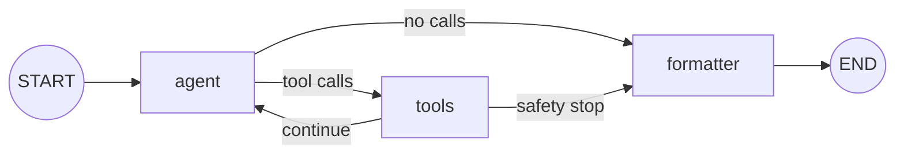

# ReAct-агент для дослідження вразливостей

## 1. Опис проєкту

Це LangGraph ReAct-агент для DevSecOps-досліджень: він знаходить вразливості конкретної версії пакета, отримує деталі CVE/GHSA/OSV, перевіряє CISA KEV та EPSS і формує структурований звіт. LLM підключається через `ChatOpenAI`. OpenAI-сумісний base URL можна передати лише через змінну оточення; якщо він відсутній, використовується стандартний OpenAI endpoint.

## 2. Доменна задача та tools

- `search_package_vulnerabilities` — OSV-пошук за ecosystem, package і version.
- `get_vulnerability_details` — деталі OSV із NVD fallback для CVE.
- `check_cisa_kev` — перевірка підтвердженої експлуатації.
- `get_epss_score` — probability і percentile FIRST EPSS.

Кожен tool має Pydantic v2 `BaseModel`, `Field(description=...)`, `field_validator` і docstring для LLM. Інформація з публічних джерел може бути неповною; відсутність CVE у KEV не означає відсутність експлуатації.

## 3. Архітектура



- `agent`: `ChatOpenAI.bind_tools()` приймає рішення.
- `tools`: контрольовано виконує tools, повертає `ToolMessage` та логує крок.
- `formatter`: `with_structured_output(VulnerabilityReport)` формує `answer`, `confidence`, severity, applicability, KEV, EPSS, mitigations, sources і limitations.
- `max_steps=10`, загальний `timeout=120s`, `LoopDetector(max_repeats=3)` налаштовуються через env.
- Повні логи зберігаються в `artifacts/trajectories/<run_id>.json`; `trajectory.json` є alias останнього CLI-запуску.

## 4. Локальний запуск

Потрібен Python 3.9+.

```bash
python3 -m venv .venv
source .venv/bin/activate
pip install -r requirements.txt
cp .env.example .env
# Заповнити OPENAI_API_KEY; OPENAI_BASE_URL залишити порожнім для OpenAI.
export PYTHONPATH=src
python -m vulnerability_agent.cli \
  --query "Досліди CVE-2021-44228: CISA KEV, EPSS та мітігації"
```

Кастомний OpenAI-compatible endpoint:

```bash
export OPENAI_API_KEY='...'
export OPENAI_BASE_URL='https://your-private-gateway.example/v1'
export OPENAI_MODEL='deployment-name'
```

## 5. Тести й артефакти

```bash
PYTHONPATH=src pytest -q
PYTHONPATH=src python test_runner.py
```

Unit-тести використовують fake LLM і mocked HTTP, тому не потребують API key. `test_runner.py` виконує чотири live test cases та записує фактичні результати до `test_results.json`. До live-запуску JSON-файли чесно мають статус `not_run`, а не вигадані результати.

| Test ID | Складність | Очікувана поведінка |
|---|---|---|
| TC-001 | simple | один OSV-пошук пакета |
| TC-002 | medium | деталі CVE та вектор атаки |
| TC-003 | complex | details + KEV + EPSS + мітігації |
| TC-004 | validation | відхилення некоректного CVE або уточнення |

Тести `test_agent.py` окремо демонструють нормальне завершення, `max_steps` і loop detection; `test_safety.py` демонструє timeout.

## 6. Docker і Compose

```bash
docker build -t vulnerability-agent:local .
docker run --rm \
  -e OPENAI_API_KEY \
  -e OPENAI_BASE_URL \
  -e OPENAI_MODEL \
  -v "$PWD/artifacts:/app/artifacts" \
  vulnerability-agent:local \
  --query "Знайди вразливості Django 3.2.1 у PyPI"

docker compose run --rm vulnerability-agent
```

`k8s/job.yaml` є прикладом Kubernetes Job. Перед застосуванням замініть image і створіть Secret із `OPENAI_API_KEY`, опційними `OPENAI_BASE_URL` та `OPENAI_MODEL`. `emptyDir` підходить лише для тимчасових артефактів; для збереження логів використовуйте PVC або object storage.

## 7. Аналіз і обмеження

Всі тести відпрацювали як очікували. Згенерували пошук вразливостей по назві пакету та версії, пошук по ідентифікатору вразливості та у разі невалідного ідентифікатора чесна відповідь про проблему без виклику інструментів.  
Провайдер з тестів не підтримує структорований вивід, тому обробка відповідей вимагає додатковий дій.

Відомі обмеження:

- OSV найкраще працює з open-source package ecosystems, а не всіма appliances.
- NVD CPE та enrichment можуть бути неповними або затриманими.
- EPSS — likelihood, не severity; CVSS сам по собі не дорівнює бізнес-ризику.
- Модель не запускає exploit-код і не повинна вигадувати мітігації.
- Поточний CLI орієнтований на Job/одноразовий запуск; HTTP API додастся пізніше.

## 8. Структура

```text
src/vulnerability_agent/
├── agent.py       # StateGraph і ReAct-цикл
├── cli.py         # CLI
├── config.py      # env-конфігурація
├── logger.py      # trajectory JSON
├── models.py      # structured output
├── safety.py      # max steps, timeout, loop detector
└── tools.py       # OSV, NVD, CISA KEV, EPSS
tests/             # unit та mocked integration tests
k8s/job.yaml       # Kubernetes Job-приклад
```
